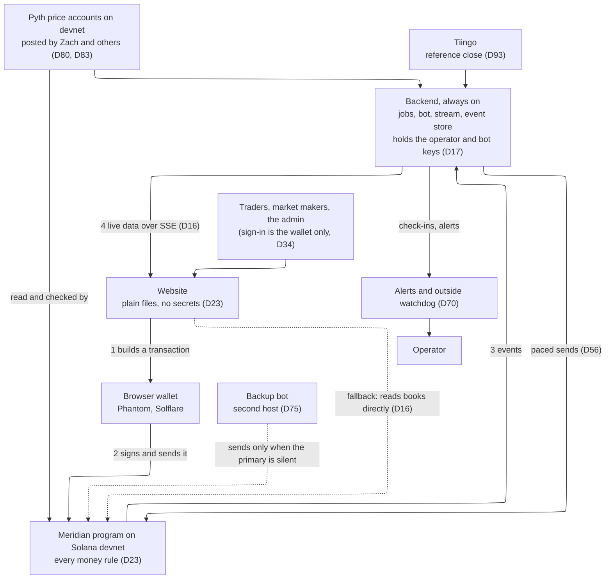
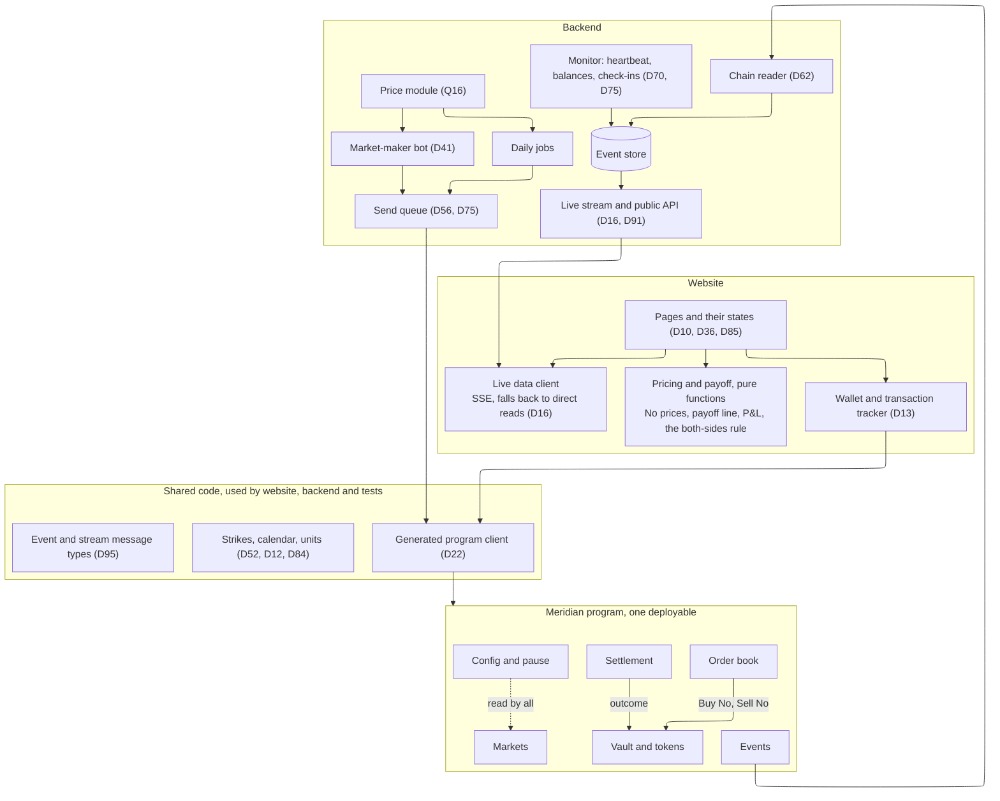
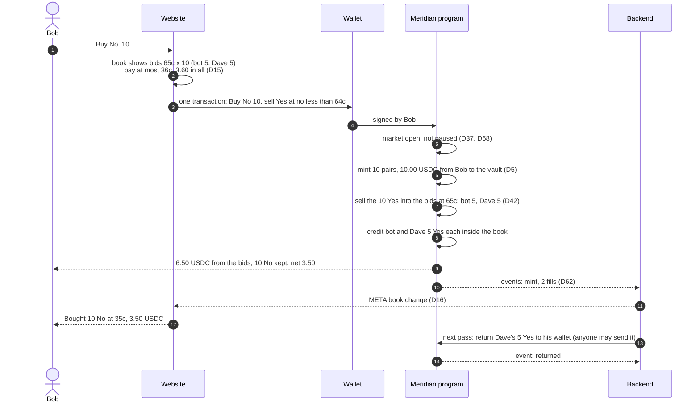
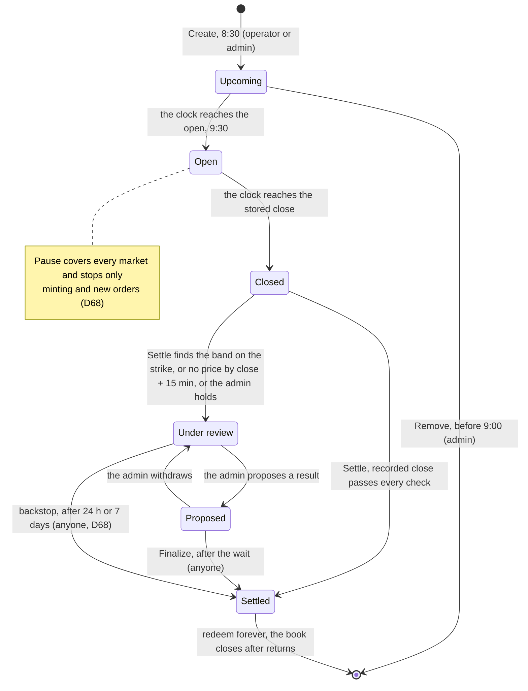
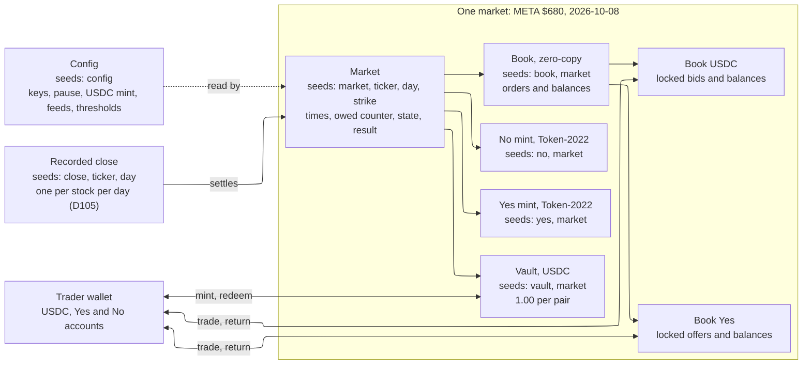
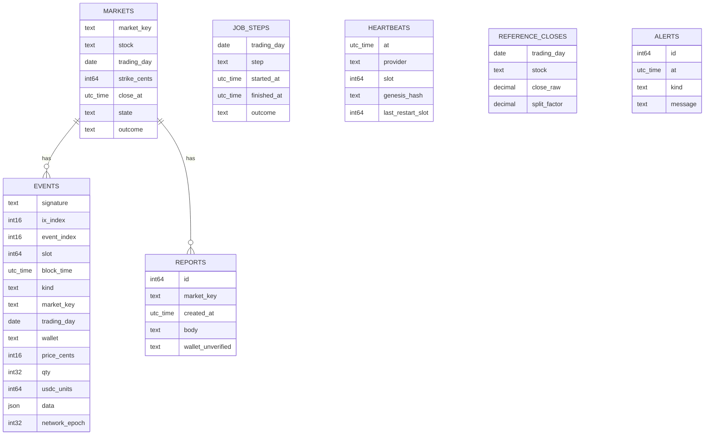
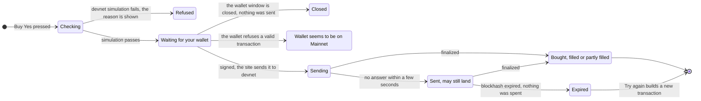
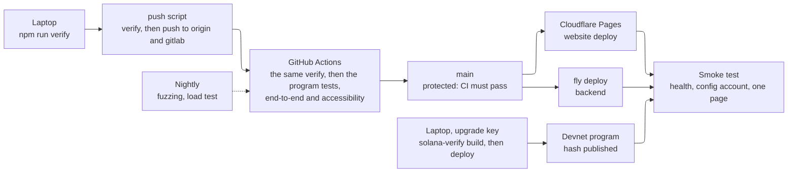
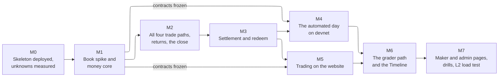

# Architecture

This file says how Meridian is built: its size, its parts, the money flow, the on-chain accounts, the contracts between the parts, the front end, the stack and the build order. It builds on [PROBLEM_SPACE.md](PROBLEM_SPACE.md) (what and why) and [USERS.md](USERS.md) (who and how, flows F1 to F20). Each section was agreed with the user before the next one started, and each becomes a decision in [DECISIONS.md](DECISIONS.md) (D90 on). Every number here comes from a script in [`scripts/arch/`](../scripts/arch/), named next to it, and a finding ID (AR.01 on) points to the research file that holds the evidence.

**Running example, used everywhere:** "META $680 or above" on a Thursday when META closed at $680 the day before. At 10:16 AM the book holds the bot's bid for 5 Yes at 64¢ and offer of 5 at 66¢, plus Dave's offer of 10 at 65¢. Alice buys 10 Yes for 6.50 USDC, and Bob buys 10 No for 3.50. META closes at $684.00, so Yes wins.

## Summary

Meridian has three parts (§2): an Anchor program on Solana devnet that holds every money rule; a Vite and React website of plain files, where the wallet signs and the site sends; and one always-on Node backend that runs the daily jobs as one repeatable check, quotes as a market maker, records events and streams live data. The backend affects timing, never the safety of money.

- **Size.** Built for the devnet demo: 10 to 50 traders a day across 46 markets. The market leader's level is computed and its path written down. Solana's limit per market is far above both (§1, D95).
- **Money.** Each market has its own vault holding $1 for every pair. The order book is on-chain. Makers' proceeds and close-time refunds are credited inside the book and returned to wallets automatically. All four trade paths are single instructions, and the vault is checked after every instruction (§3, D99 to D101).
- **Settlement.** Anyone may record a genuine Pyth price published in the 5 seconds before the close. Settle uses that record. A market whose band contains its strike, or that has no price, is held for an override that takes the official close and waits at least an hour. No market waits more than a week (§4, D102 to D106).
- **Accounts.** Yes and No are named Token-2022 mints with Permissioned Burn, so only Redeem destroys them. A book holds 64 resting orders a side. About 0.61 SOL a day is kept for good (§5, D94, D107 to D109).
- **Contracts.** The program has 23 instructions, an error table in USERS.md's words, and a backend API of one stream plus read endpoints and two rate-limited write paths (§6, D110 to D113).
- **Operations.** Alerts go by Telegram, a Healthchecks.io watchdog runs on New York time, Alchemy is the second RPC provider, and the liveness rule is stated in raw and adjusted figures (§8, D117 to D121).
- **Stack and hosting.** Every pin is at least two weeks old (Anchor 1.2.0). Hosting is Fly.io plus a standby on Northflank, with SQLite and Litestream and the site on Cloudflare Pages, for about $2.37 a month (§9, D122 to D125).
- **Delivery.** Golden examples are shared by Rust and TypeScript, one `verify` command runs locally and in CI, and `main` is protected. Eight milestones run from M0, deployed on day one, to M7. Every spec deliverable is done by M6 (§10, §12, D126 to D131).

| § | Section |
|---|---|
| 1 | Scale and availability |
| 2 | System overview |
| 3 | The money flow |
| 4 | Market lifecycle |
| 5 | On-chain accounts and the data model |
| 6 | Instructions and contracts |
| 7 | Front end |
| 8 | Security, privacy and observability |
| 9 | Stack and hosting |
| 10 | Testing and delivery |
| 11 | Configuration, repository layout and known limitations |
| 12 | Build order |

## 1. Scale and availability

Meridian carries three kinds of traffic: on-chain transactions (every trade, quote and job step), our backend's requests to Solana's RPC servers (to send transactions and read what happened), and live updates pushed to browsers. Alice's 10:16 Buy Yes is one transaction. Our backend reads it back once to record its events (D62), and one book update goes to every open tab watching META (D16).

### Sizing

| Level | What it stands for | Trades a day | Busiest market at its peak | Source |
|---|---|---|---|---|
| **L1: devnet demo** (built for) | Peak6's graders and classmates: 10 to 50 traders a day, 10 to 20 actions each (assumed, confirmed by the user) | 100 to 1,000 user transactions, plus 148 to 202 from the bot and 159 from the jobs | 0.002 transactions a second | `scale-demo.mjs`, `requotes.mjs` |
| **L2: the market leader** | Kalshi's S&P 500 "above/below at 4 PM" event, the closest product to ours, times our 7 stocks | about 73,500 | about 5.6 a second | `scale-levels.mjs`; AR.07 |
| The whole channel | Every daily finance contract on Kalshi and Polymarket | about 167,000 | (as L2) | `scale-levels.mjs`; AR.07 |
| **L3: Solana's ceiling** | Every trade in one market writes that market's book account, which gets at most 12M compute units per block (the conservative figure; Agave's code has 24M) | (not a usage level) | 448 to 1,794 taker transactions a second, for 120k to 30k compute units each | `ceiling.mjs`; AR.01, AR.08 |

How the levels are computed:

- **L1.** 46 markets at the 9 October closes (49 at most, D6). The jobs send 92 transactions to create the markets (2 each, assumed), 7 for the first quotes, 46 for the close sweep, and 7 to record closes plus 7 to settle. Users send 100 to 1,000 transactions, 30% of them in the busiest hour (assumed). The bot sends 148 batch re-quotes a day at the median and 176 at p95 with Zach's hourly prices and 2% daily moves, or 202 at p95 with 3% moves. At p95 it sends no more than 9 in any 10 seconds.
- **L2.** Kalshi averages 180 contracts per trade: $68.7B of face value over 381.0M trades. The 4 PM S&P event traded 1,893,297 contracts, about 10,500 trades. Its busiest strike traded 797,377 contracts (about 4,400 trades), 45.6% of them in the last hour, which is 0.56 trades a second. The peak second is assumed to run at 10 times that hour's average. Kalshi has no single-stock daily markets that the research found, and Polymarket's take $121 to $27,591 a day each, so a Kalshi index event times 7 is a generous stand-in.

### What binds, and what doesn't

The chain doesn't bind even at L2: the busiest market needs 5.6 transactions a second against a ceiling of at least 448. These do:

1. **Devnet's per-address request limit** (100 per 10 seconds, 40 for any one method; AR.08). In L1's busiest hour, with the send queue at its D56 cap, our backend uses 5.0 of its 10 a second (`rpc-budget.mjs`). L2 needs a paid provider.
2. **The live stream's fan-out.** At L1 the stream sends 6 messages a second in all. At L2 it would send 157,000 a second if every tab got every change, or 22,000 if each tab got only its own stock (assuming 5,000 tabs and 10 order changes per trade; `rpc-budget.mjs`).
3. **Job bursts at D56's pace of 4 sends a second.** Creating the markets takes at least 23 s, inside the 1,800 s from 8:30 to 9:00. The close sweep takes at least 11.5 s, and recording the close plus settling takes 3.5 s (`scale-demo.mjs`).
4. **Devnet SOL.** About 0.445 SOL a day stays locked for good: D50's 0.008 per market plus D94's 0.0017. (§5 refines this to about 0.61 SOL a day with the recorded closes and token names.) That is about 9.3 SOL over 21 trading days, a regular top-up for the operator (`scale-demo.mjs`).

### Built for L1, with the path to L2 written down

Three preparations are built now, so that reaching L2 means configuration and hosting, not a redesign:

- every live-stream message carries a topic (its stock);
- every send goes through the one shared queue (D56);
- reading our program's transactions sits behind one module, so a paid streaming feed can replace polling.

The path to L2, not built:

- a paid Solana provider with a streaming feed, and higher send limits;
- streaming stock prices for the bot, which then sends about 3,000 batch re-quotes a day (`requotes.mjs`), still no more than 9 in any 10 seconds at p95;
- several stream servers behind a shared message bus, with tabs subscribed to their stock only;
- an event store sized for about 800,000 rows a day.

The program needs no change for L2. The M1 spike measures how many orders one book holds and the compute per match (D21).

### Tests for each level

- **L1 load test:** "a demo day in 20 minutes" on a local chain with the fake clock (D11). It runs 46 markets, the bot, 50 simulated traders doing 20 actions each with 30% in one hour, and 50 stream clients. It passes when every job finishes inside its window (markets by 9:00, the sweep by about 4:01, settlement within 10 minutes of the posted close), nothing is rate-limited at D56's pace, and the stream meets the targets below. A small real-devnet run with about 10 traders meets the real request limits.
- **L2 load test:** one market at 6 taker transactions a second for 10 minutes on a local chain, measuring compute per transaction against the account cap; and 5,000 simulated stream clients against one backend.
- **L3:** computed only.
- **Race tests**, for the moments where two actions collide:
  - two buyers for the last 5 Yes (no over-fill; the second gets what is left or nothing);
  - an order in the last second before the stored close (D37);
  - settle sent twice (the second fails "already settled");
  - the recorded close replaced by a later valid price while settle runs (D83);
  - cancel against fill;
  - redeem twice;
  - sweep against cancel.
- **Outage drills:**
  - the backend killed mid-day (the site reads the chain directly, D16; the jobs resume without double sends, D23);
  - the chain halted mid-trading and again across 4:00 (settlement still uses the price at or before the close, D19);
  - one RPC provider failing (failover, D75);
  - the primary host down while the backup bot runs (D75);
  - the database lost.

### Availability

One always-on backend, a backup copy of the bot on a second host (D75), backups of the database, and no standby for the live stream or the database.

- **If the primary host dies,** live updates, History and the Timeline stop until it restarts. Trading continues: browsers read the books from Solana (D16), the backup bot runs the jobs (they're safe to run twice, D23), and no money is at risk, because the program holds every money rule (D23).
- **What a lost database can't rebuild from the chain** is our own off-chain records: job check-ins, the heartbeat log (D75's evidence for counting outage days), problem reports (D91) and the Tiingo reads (D93). They are backed up at least once a day, after settlement. Everything the chain recorded can be re-read from it (D62).
- **Rejected:** a hot standby with a replicated database (a second paid host, out of proportion for play money), and backups only (that would undo D75).

### Response-time targets

| What | Target | Source |
|---|---|---|
| A page's first byte | 0.8 s or less at p75 | web.dev, Time to First Byte (AR.08) |
| Main content painted | 2.5 s or less at p75 | web.dev, Largest Contentful Paint (AR.08) |
| Reaction to a click | 200 ms or less at p75 | web.dev, Interaction to Next Paint (AR.08) |
| From approving in the wallet to "Bought 10 Yes" | 3 s or less at p95 | Our own target: devnet finalizes within about a second of confirming (AR.01). Measured at M0 |
| A fill appearing in other tabs | 2 s or less at p95 | Our own target; measured in the L1 load test |
| Markets created; markets settled | by 9:00 AM; within 10 minutes of the close | The spec |

## 2. System overview

The system has three parts (D23):

- **Our program on Solana** holds every money rule.
- **A website of plain files** has no secrets. It only builds transactions; the trader's wallet signs and sends them.
- **One always-on backend** runs the daily jobs, the market-maker bot and the live stream, and holds the operator and bot keys. It decides when things happen, never whether money is safe.

### Modules

Each module owns something and keeps one rule about it: "only this module changes that". The modules are also the lanes for parallel work in the implementation phase: one module, one owner.

| Module | Owns | Rule it keeps |
|---|---|---|
| **Program: Config and pause** | The admin and operator keys, tickers and pinned feed IDs, accepted Pyth receivers (D80), thresholds, ladder settings (D49), the USDC mint (D32), the pause flag | Only the admin's signature changes it (D24, D34). Pause stops only minting and new orders (D68). |
| **Program: Markets** | Each market's ticker, date, strike, open and close times and state, at an address fixed by ticker, date and strike (D56) | A strike never changes (D53). A market can be removed only before 9:00. Every time rule reads the market's stored times (D11, D51). |
| **Program: Vault and tokens** | Each market's USDC vault, its Yes and No token types (D94) and the owed counter (D64) | The only module that creates or destroys Yes and No or moves vault USDC. After every instruction, the vault holds at least what is owed, and supply never exceeds the counter (D64). |
| **Program: Order book** | Resting orders and the tokens or USDC they lock | The only module that moves locked funds. It accepts orders only between the market's open and close (D37, D46). A trade happens at the resting order's price, never beyond the incoming order's worst price (D42, D15). A self-trade cancels the resting order (D90). The close refunds every resting order (D37). |
| **Program: Settlement** | Each stock's recorded close (D83), each market's outcome, holds and override proposals | An outcome is written once (D2). It comes either from a recorded genuine Pyth close that passes D28, D57 and D26, or from the override after its wait (D63). D58 and D68 say who may call when. |
| **Program: Events** | One event for every action (D62, D70) | Nothing secret in any event. |
| **Backend: Daily jobs** | Creating markets, adding strikes, the close sweep, recording the close, settling, closing finished books, the audit | Every action is safe to repeat (D23). Times come from the calendar (D12). It never decides an outcome; the program checks everything. |
| **Backend: Bot** | Its quotes | Its own wallet, with no program powers (D41). |
| **Backend: Price module** | Every price read: Pyth accounts and Tiingo | The only place prices are read (Q16). It pre-checks D28 before sending, but the program is the authority. |
| **Backend: Send queue** | Every transaction the backend sends | The only path from the backend to the chain. It keeps D56's pace, re-signs only after the old transaction expires, and fails over between two providers (D75). |
| **Backend: Chain reader** | Turning our program's transactions into stored events | The only writer of rows that came from the chain. It catches up after a restart (D62). |
| **Backend: Event store** | Rows from the chain, which can be rebuilt from it, and our off-chain records, which are backed up (D95) | — |
| **Backend: Live stream and API** | The stream and the read endpoints | Read-only, except problem reports (D91). The stream sends a snapshot and then changes, each message numbered and carrying its topic (D16, D95). |
| **Backend: Monitor** | The heartbeat from two providers, the halt detector, balances, watchdog check-ins | Alerts reach a person (D19, D32, D70, D75). |
| **Website: Pricing and payoff** | No prices, the payoff line, P&L, the both-sides check, the large-order confirm | Pure functions: the same code runs on screen and in the tests (D45, D10, D62, D9, D88). |
| **Website: Transaction tracker** | Building, signing and tracking transactions | It never shows a sent transaction as failed, and never re-sends before expiry (D13). |
| **Shared code** | The generated client, strikes, calendar, units, message types | One copy of each (D52's shared function, D84's units). |

**Alice's 10:16 Buy Yes, through the modules:**

1. **Website.** The pricing functions show "Buy Yes 65¢" and the payoff line. She enters 10, with a worst price of 66¢.
2. **Transaction tracker.** It builds Place Order (buy 10 Yes, at most 66¢) with the generated client. Her wallet asks for one approval and sends the order to devnet.
3. **Program.**
   - Config confirms the market isn't paused, and Markets confirms it is between open and close.
   - The order book matches Dave's 65¢ offer: 6.50 USDC moves from Alice to Dave, and 10 Yes from the book's escrow to Alice.
   - Events records the fill.
4. **Transaction tracker.** It sees the transaction finalized and shows "Bought 10 Yes at 65¢ · 6.50 USDC".
5. **Backend.**
   - The chain reader stores the fill.
   - The stream sends a "META" book change to every tab watching META, so Bob's book updates within 2 seconds.
   - Alice's Portfolio reads her balances from the chain; her History comes from the API.

### The daily jobs: one repeatable check

The daily jobs are one loop that runs every 30 seconds (item 16, D29). It compares what should exist now, given the calendar, the config and the clock, with what the chain shows, and sends only what is missing.

Suppose the backend crashes at 8:41, after creating 30 of 46 markets. After the restart, the next pass sees 16 missing and creates them, with no memory of what it did before. Restarts, devnet halts (D19) and the backup's takeover are therefore all the same case.

The cost is about one read of every market account per pass; 46 accounts fit in one `getMultipleAccounts` call. Each milestone still writes a Timeline row and a watchdog check-in (D70).

| From (ET) | What should be true | If not, it sends |
|---|---|---|
| 8:00 | Each stock's previous close is known from the recorded close and Tiingo, and the two agree within D55's threshold | Nothing. A stock that disagrees is skipped, or marked "one source" (D55, D82), with an alert |
| 8:30 to 9:00 | Every planned market exists | Create market, retrying with growing waits; alert at 9:00 (D56) |
| About 9:35 | A strike sits within 3% of each stock's price | Add strike, once per stock per day (D54) |
| The stored close | No resting orders in a closed market | The close sweep (D37) |
| From the close until recorded | Each stock's close is recorded from a valid Pyth price published at or before the close | Record close (D81, D83). At close + 15 minutes, that stock's markets are held instead (D83) |
| After a recorded close | Every market on that stock is settled or held | Settle (D26); alert at close + 20 minutes (D8) |
| After settlement | Each settled market's book account is closed | Close book (D50, D27) |
| Next trading day | Every settlement has been compared with the reference close | The audit, with alerts on any mismatch (D26, D93) |

### The backup: standby, taking over on silence

The backup copy of the backend runs on a second host (D75) in standby:

- Once a minute it checks the primary's health and the chain's progress.
- It takes over after 3 silent minutes.
- It hands back once the primary has been healthy for 5 minutes.

Both hosts use the same bot wallet. If both were active, their bots would keep replacing each other's quotes, which doubles fees and the request load. A brief overlap during handover is harmless: every job action is safe to repeat, and a quote batch replaces that wallet's earlier quotes. The live stream and the event store don't fail over (§1, Availability).

### One program

The program is one deployable with the six modules above. Buy No has to mint pairs and sell their Yes in one instruction (D5), and Sell No has to buy Yes and close pairs in one (D38). So the order book and the vault work together inside every trade.

A separate book program would add a cross-program call, extra compute and extra accounts to each of those trades, and would split the vault rules across two codebases. If we fall back to Phoenix (D21), the change stays inside the program, the generated client and the chain reader.

### Seams: what is faked, and where the real part plugs in

| Seam | Local (`make dev`) | Devnet | Later |
|---|---|---|---|
| Price source | Fake Pyth accounts in the local chain (D11) | Pyth accounts posted by Zach and others, under both receivers (D80) | Our own Pyth key, as a config change only (Q16) |
| Clock | A fake clock with the demo-clock panel (D89) | The chain's clock | — |
| Reference close | A fixture file | Tiingo (D93) | — |
| RPC | The local chain | Public devnet plus a free-tier provider (D75) | A paid provider with a streaming feed (L2, §1) |
| USDC | A local test mint | Circle's devnet USDC (D32) | Our own "Test USDC", D32's fallback |
| Outcome tokens | Token-2022 with Permissioned Burn | The same (D94) | Classic tokens for new markets if the M0 wallet test fails (D94) |
| Order book | Ours | Ours | Phoenix if the M1 spike fails (D21) |
| Alerts and watchdog | Printed to the console | The alert channel and watchdog (chosen in §8 and §9) | — |
| Live stream | One process | One process | Several behind a message bus (L2, §1) |

## 3. The money flow

Three ideas run through this section:

- **The vault** holds exactly $1 for every Yes and No pair in existence, and pays the winners (D2, D64).
- **The book's locked funds.** A resting order locks what it offers: Carol's bid for 10 Yes at 60¢ locks 6.00 USDC, and Dave's offer of 10 Yes locks his 10 Yes. The order book module holds these, separately from the vault.
- **Maker and taker.** The maker is the order already resting on the book; the taker is the incoming order that trades against it. When Alice buys Dave's offer, Dave is the maker and Alice the taker.

### The running example's day

`money-flow.mjs` replays the day. Every person starts with 20.00 USDC, and the $1 rules are checked after every step: the vault holds at least what it owes, Yes and No supply both equal the pairs outstanding, and no USDC appears or vanishes.

| Time | What happens | Vault | Owed |
|---|---|---|---|
| 9:10 | Dave mints 10 pairs | 10.00 | 10.00 |
| 9:30 | The bot mints 5 pairs, offers 5 Yes at 66¢ and bids for 5 at 64¢ | 15.00 | 15.00 |
| 10:00 | Carol bids for 10 Yes at 60¢, locking 6.00 | 15.00 | 15.00 |
| 10:16 | Dave offers 10 Yes at 65¢; Alice's Buy Yes takes all 10 for 6.50 | 15.00 | 15.00 |
| 10:59 | The bot and Dave each bid for 5 Yes at 65¢ | 15.00 | 15.00 |
| 11:00 | Bob's Buy No mints 10 pairs and sells the 10 Yes to the bot and Dave at 65¢: he pays 3.50 net | 25.00 | 25.00 |
| 11:30 | Dave closes 5 pairs and gets 5.00 back (D38) | 20.00 | 20.00 |
| 2:00 PM | Carol cancels and gets 6.00 back | 20.00 | 20.00 |
| 4:00 PM | The close sweep refunds every resting order (D37) | 20.00 | 20.00 |
| ~4:02 PM | META closed at $684.00: Yes wins | 20.00 | 20.00 |
| After | Every Yes is redeemed for 1.00; every No is burned (D94) | 0.00 | 0.00 |

Results: Alice +3.50, Bob −3.50, Carol 0.00, Dave −1.75 (as in USERS F15) and the bot +1.75. They sum to 0.00, since there are no fees (A1).

### The four trade paths

Each path is one signed transaction and one instruction:

| Button | The instruction | Example |
|---|---|---|
| Buy Yes | Buy Yes from resting offers | Alice: 10 at 65¢, 6.50 |
| Sell Yes | Sell Yes into resting bids | Alice at 2:30: 10 at 80¢, receives 8.00 |
| Buy No | Mint pairs, sell their Yes into resting bids, keep the No. It mints only as many pairs as it sells (D5) | Bob: pays 10.00 for 10 pairs, receives 6.50, keeps 10 No for 3.50 |
| Sell No | Buy Yes from resting offers, then close each Yes with a No for $1. It closes only as many pairs as it bought (D38) | Bob at noon: pays 8.00 for 10 Yes, gets 10.00 back, receives 2.00 |

Bob's Buy No is the hardest path:

### Matching rules

- **Priority.** Best price first, then oldest first.
- **Trade price.** A trade happens at the resting order's price (D42), and never beyond the taker's worst price (D15).
- **Self-trade.** A self-trade cancels the resting order and matching continues (D90).
- **Order types.** A Market order fills what it can now, and the rest is not placed. A Limit order fills what it can, and the rest rests at its price.
- **Fills per instruction.** There is a maximum, set from the compute measured in the M1 spike (D21, D30). When it is reached, the order stops as a partial fill.

**The default worst price on a Market order (D15)** is the price of the last book level needed to fill the whole quantity, moved 1¢ against the trader. The order then still fills at the prices on screen if the book moves by a cent. A Limit order uses the trader's own price. Computed by `cap.mjs` on USERS.md's books:

| Order | Default worst price |
|---|---|
| Alice, Buy Yes 10 at 10:16 | 66¢, 6.60 in all (USERS F4) |
| Alice, Buy Yes 15 | 67¢, 10.05 in all |
| Alice, Buy Yes 20 | The book holds only 15, so the ticket offers a limit order instead |
| Bob, Buy No 10 at 11:00 | Sells Yes at no less than 64¢, so No costs at most 36¢: 3.60 in all (USERS F5) |
| Alice, Sell Yes 10 at 2:30 | Receives at least 79¢ each, 7.90 in all |
| Bob, Sell No 10 at noon | Receives at least 19¢ each, 1.90 in all |

### Where makers' proceeds and refunds land: in the book, then returned automatically

On Solana a transaction must list every account it touches before it runs. So a taker's transaction can't easily pay makers it can't predict. Phoenix and Manifest credit makers inside the market account; OpenBook queues fills for a separate crank (AR.09).

Meridian credits a balance inside the book, which needs no listing, and then returns it:

1. **Fills, cancels and the 4:00 sweep credit the owner's balance in that market's book.** The taker's own side moves straight to and from the taker's wallet, since the taker's accounts are in the transaction anyway. This means any number of makers per transaction, up to the fill limit, and a sweep of one transaction per market.
2. **"Return to owner" moves a balance to the owner's own wallet accounts.** Anyone may send it, and it can pay no one else. The repeatable check (D97) sends it for every balance on its next pass, about 30 seconds later. The bot collects its own balances inside its quote batches.
3. **The owner can always send "return to owner" themselves**, so a backend outage delays a return but never traps money (D23).
4. **After the sweep, everything is returned, and then the book account is closed** to recover its deposit (D50).

On screen, USERS.md's wording stays ("Refunded at the close · 3.60 USDC returned"). While a return is pending, the order shows "on its way to your wallet". If an owner has closed the wallet account a return needs, the backend pays about 0.002 SOL to re-create it.

Rejected:

- **Paying makers straight to their wallets.** The taker would have to predict the makers, at most about 40 per transaction. Fills would stop early whenever the book moved, the sweep would need several transactions, and a closed receiving account would block a fill.
- **Leaving balances for owners to withdraw by hand** (Phoenix). Users would have to collect, and a book couldn't close until every owner had.
- **OpenBook's crank** (ruled out by D20 and D29).

### Every place a trade can break

| Breaks at | Chain shows | User sees (USERS.md wording) | How it is settled |
|---|---|---|---|
| The wallet popup is closed | Nothing | "You closed the wallet window. Nothing was sent." | — |
| Simulation fails: wrong network, or too little SOL | Nothing | F2's messages | — |
| Sent, not landed yet | Nothing yet | "Sent, may still land" | The tracker polls until the transaction lands or expires, and never re-sends first (D13) |
| Expired without landing | Nothing | "Your order expired before it reached the network. Nothing was spent. [Try again]" | A new transaction |
| Refused: after the close, or paused | Only the network fee | F4's messages | — |
| The book moved: partial fill or none | The fills that happened | "Bought 5 of 10 Yes at 66¢ …" or "No Yes was bought …" | Done. A Market order's remainder is not placed |
| A self-trade | The resting order cancelled, the rest filled | "Your offer of 10 Yes at 65¢ was cancelled …" (D90) | Done |
| The backend is down | The trade | "Bought …" still shows. The book is read from the chain, and History is unavailable (F13) | The chain reader catches up after restart (D62); returns wait for the backend or the owner |
| Devnet halts mid-flight | Nothing, or the trade after recovery | "Sent, may still land", then the result or expiry (F14) | Everything is re-read on recovery (D19) |
| A maker's proceeds are pending return | A balance in the book | "5 Yes on their way to your wallet" | The next pass, or the owner |

### Guards against doing the same thing twice

- **One landing per transaction.** A signed transaction can land at most once.
- **One live attempt per order.** The tracker re-signs only after the old transaction has expired (D13, D56).
- **Order IDs.** Each order carries an ID chosen by its sender. A second order with the same ID from the same owner in the same market is refused, which covers a double click and the bot re-sending after expiry.
- **Market creation.** Market addresses are fixed (D56), so a repeated create fails as "already exists".
- **Settle.** An outcome is written once, so a second settle fails with "already settled".
- **Redeem.** Redeeming burns the tokens, so a repeat finds nothing.
- **Return to owner.** A return moves the whole balance, so a repeat finds zero.

### Showing each failure in a demo

No "break the code" switch is needed:

| To show | Do this |
|---|---|
| Nothing filled | Set "pay at most" below the best offer |
| A partial fill | Buy 20 when 15 are offered |
| A self-trade | Offer Yes, then buy across your own offer |
| A refused order | In `make dev`, press "Close at 4:00" on the demo clock (D89), then submit |
| A paused market | Run the local admin script's pause |
| The direct-read fallback and pending returns | Stop the backend |
| Wrong network | Switch the wallet to Mainnet |
| A closed popup | Click Reject in the wallet |

## 4. Market lifecycle

A market moves through states: Upcoming, Open, Closed, then a result. A state that follows from the clock is **worked out** and never stored: nobody has to press "open" at 9:30, and a dead backend can't make a market miss its open. A state that needs a decision is **stored** by a transaction and recorded as an event.

**Worked out, never stored:**

- Upcoming, Open and Closed come from the market's stored times and the chain's clock. Minting opens at 9:00 (D46), orders open at 9:30, and orders close 5 seconds before the stored close.
- Paused comes from the config flag.

**Stored, each with an event:**

- Under review, with its reason: the band contains the strike (D59), there is no price (D83), or the admin has held it (D68), which covers a halted stock (D65).
- Proposed, with the result, the official close, its source and the time it becomes final.
- Settled, with the result, price, band and publish time, and whether it came from the oracle, the override or the backstop.
- Book closed.

### Who may do what, and when

| Move | Who | Allowed when | What people see |
|---|---|---|---|
| Create market | Operator or admin (D24) | Before the open, once per ticker, date and strike (D56) | Cards appear at 9:00 (D46) |
| Remove market | Admin | Before 9:00 only (D53) | "Strike removed" |
| Mint pairs | Anyone | From 9:00 until orders close, not paused (D43) | "Minted 10 pairs · 10.00 USDC" |
| Place order | Anyone | From the open until 5 seconds before the stored close (by the chain's clock), not paused (D37, D46, D102) | F4 to F7 |
| Cancel order | The order's owner | Any time while the order rests; never paused (D68) | "Order cancelled · 3.60 USDC returned" |
| Close pairs | Any holder of both | Before the market is Settled, Under review included; never paused (D38, D68) | "Closed 5 pairs · 5.00 USDC returned" |
| Close sweep | Operator | After the close (D37) | "Refunded at the close · …" |
| Return to owner | Anyone, paying only the owner | While a balance waits in the book (D99) | "on its way to your wallet", then "returned" |
| Record close | Anyone | A genuine Pyth price published within 5 seconds before the close (below) | Timeline: "META close recorded $684.00 · 4:00:00 PM ET" |
| Settle | Operator for 24 hours after the close, then anyone (D58) | A close is recorded, or 15 minutes have passed since the close | "Yes wins", or "Under review" with its reason |
| Hold | Admin | Before the market is Settled (D68) | "Under review: the admin has held this result while a price problem is checked." |
| Propose, withdraw | Admin | Under review (D63, D104) | "Proposed: No wins, final at 5:20 PM ET" / "Withdrawn" |
| Finalize | Anyone | After the wait (D104) | "No wins · official close $679.97 · set by the admin" |
| Backstop settle | Anyone | An admin hold: after 24 hours, if the recorded close passes every check. A band containing the strike: after 7 days, on Pyth's price alone (D68) | The result |
| Redeem | Any holder | Settled, forever; never paused (D66, D68) | "Redeemed 10 Yes for 10.00 USDC" |
| Close book | Anyone | Settled and every balance returned; the deposit goes back to whoever paid it (D50, D99) | — |
| Pause, unpause | Admin | Any time (D68) | "Trading is paused by the admin …" |

### The recorded close (D83)

- **One record per stock per trading day.** Anyone may submit a Pyth price account. The program checks D28's rules (an accepted receiver per D80, full verification, the pinned feed, a price above zero, a sane exponent) and D57's: the price was published at or before the close and no more than 5 seconds earlier, and the chain's clock has passed the close.
- **Only a later price replaces it.** A new price replaces the record only if it was published later, and still at or before the close. Nobody can swap in an older price they prefer.
- **The record freezes at the first settle on that stock**, so every META strike settles on the same price.
- **The bot's timing:**
  - It records the first valid price it sees.
  - It settles as soon as the record holds a price published exactly at the close, or at close + 5 minutes with the best price inside the window.
  - If nothing is recorded by close + 15 minutes, settle marks that stock's markets "Under review: no price".
- **The next morning's job reads the record** as the previous close (D82).

### The override (D63, D104)

The admin proposes a result together with the exchange's official close and its source. The proposal becomes final no earlier than 1 hour after the close and 1 hour after the proposal.

It waits 24 hours instead in two cases:

- there is no reference price (no close was recorded);
- the proposed close is more than 0.5% from the recorded Pyth price.

In the running example's straddle, Pyth's 4:00 price is $680.02 ± $0.04. A typo of $697.97 is $17.95 away, so it needs the 24-hour wait and is visible to everyone, with time to withdraw it. The official close of $679.97 is 5¢ away, so it becomes final at 5:20 PM. Withdrawing and proposing again restarts the wait.

### Settlement numbers

| Setting | Value | Evidence (`settle-numbers.mjs`; AR.04, AR.10) |
|---|---|---|
| Orders close before the stored close (D37) | 5 s, by the chain's clock | Devnet's clock ran 1.5 to 2.4 s behind this machine, which ran about 0.9 s ahead of a Date header |
| Publish-time window (D57) | 5 s, ending at the close | 23 of 25 closes seen were published at exactly 4:00:00. A price published 30 s early can be off by about ±$0.49 on META (at 2% daily moves), more than twice its median band of ±$0.20 |
| Widest band accepted (D26) | 25 bps of the price (META ±$1.71) | The widest band seen at the close was 10.50 bps; the regular-session p99 was 24.41 bps; this rejects the 490.72 bps outlier |
| Override bound (D63) | 0.5% of the recorded Pyth price | Catches the $697.97 typo; lets in the $679.97 official close |
| Override wait outside the bound or with no reference (D63) | 24 h | D63's example |
| Two-source previous close (D55) | 2% | A split moves the close by a third or more. A false skip costs a stock all of its markets for the day, while a 2% error moves strikes by at most one $10 step |
| Add-strike price age (D54) | at most 65 min | The same line as "may be out of date" (D87), suited to hourly posts |

## 5. On-chain accounts and the data model

On Solana, an account is a box with an address, a fixed size and a refundable deposit (rent) proportional to its size. Our program finds every account at a **program-derived address**, computed from words such as "market" + "META" + "2026-10-08" + "680". Only our program can sign for that address, and a swapped account fails because its address is wrong. The order book is **zero-copy**: it is read in place rather than copied, which matters for a large account that every trade touches.

### Accounts, sizes and deposits

All of these are estimates from `accounts.mjs`; D50 measures the real sizes at M0.

| Account | Address from | Holds | Size | Deposit | Kept or returned |
|---|---|---|---|---|---|
| Config | "config" | The admin key, a pending admin key (rotation in two steps), the operator key, the USDC mint, the accepted Pyth receivers (D80), up to 8 tickers with pinned feed IDs, the pause flag, and the thresholds the program enforces (D102 to D106) | 682 B | 0.0056 SOL | Once |
| Recorded close | "close", ticker, day | Price, band, exponent, publish time, the price account it came from, who recorded it, frozen or not (D105) | 154 B | 0.0020 SOL per stock per day | Kept: the next morning's job and the market's evidence read it |
| Market | "market", ticker, day, strike | Identity, mint-open, open and close times, the linked accounts, the owed counter (D64), state and hold reason, the result with its price, band and publish time, any proposal | 353 B | 0.0034 SOL | Kept for good: redeem stays open (D66) |
| Yes mint, No mint | "yes" / "no", market | Token-2022 with Permissioned Burn (D94) and a name wallets show, such as "META 680+ Yes 10/08" (D108). Decimals 0. The mint and burn authority is the market's address; no freeze authority | 422 B each | 0.0038 SOL each | Kept for good (standard mints can't be closed, F3.13) |
| Vault | "vault", market | USDC, exactly 1.00 per pair outstanding | 165 B | 0.0020 SOL | Kept for good |
| Book | "book", market | 64 orders a side and 64 traders (D107) | 6,728 B | 0.0477 SOL | Returned after settlement and the returns (D50, D99) |
| Book USDC, Book Yes | "book_usdc" / "book_yes", market | USDC locked by bids, Yes locked by offers, and owners' free balances | 165 B, 170 B | 0.0041 SOL together | Returned with the book |
| A trader's Yes and No accounts | The wallet's associated accounts | Their tokens | 170 B each | 0.0041 SOL per market | Returned when closed, which Redeem does (D94) |

Per market, 0.0130 SOL is kept for good (about 0.0100 plus 0.0031 for token names; `accounts.mjs`), and 0.0518 SOL goes out and comes back. At 46 markets a day, with the 7 recorded closes, that is about **0.61 SOL a day kept for good** and **2.38 SOL a day out and back**.

The vault and the book's USDC are separate accounts, so anyone can check "vault = pairs outstanding × 1.00" by reading one balance. At 6,728 bytes the book is under the 10,240 bytes a program can create in one call (AR.11), so Create Market creates it. D22's client-created book is needed only for books above that size.

### The order book's layout

**Orders.** One order takes 24 bytes: a sequence number for time priority, the sender's order ID (D101), the quantity, the trader's index and the price in cents. Bids are kept sorted highest first and asks lowest first, so the best price is always at the front, and adding an order shifts at most 64 entries.

**Traders.** One trader entry takes 56 bytes: the owner, their free USDC, their free Yes and their open-order count. An entry is reused once its balances are zero and it has no open orders.

**Full book.** A full side or a full trader table refuses new resting orders with "This market's order book is full"; Market orders still trade.

At 10:16 the META $680 book holds:

- asks: 65¢ × 10 (Dave), then 66¢ × 5 (bot)
- bids: 64¢ × 5 (bot), then 60¢ × 10 (Carol)
- traders: the bot, Carol and Dave

After Alice's buy, Dave's offer is gone and his entry holds 6.50 USDC free until it is returned (D99). Alice was the taker, so she never enters the table.

### Rules the program enforces even if other code has a bug

| Rule | How | What it stops |
|---|---|---|
| Admin and operator actions need the stored key and its signature | `has_one` plus `Signer` (D34) | Passing in the admin's address without the key |
| Every account sits at its expected address | Seeds checked for the market, vault, book, its token accounts and the mints | Swapped accounts (D30) |
| Token accounts match their mint and token program | USDC is the configured mint on the classic token program; Yes and No are this market's mints on Token-2022 | Fake tokens. The devnet build refuses mainnet USDC (D32) |
| No account is passed twice where it is written | An explicit duplicate check | The duplicate-account attack (D30) |
| Prices are 1 to 99¢, quantities are above 0, fills stay within the limit | Argument checks | Nonsense orders |
| Minting and orders happen only inside their windows | Stored times compared with the chain's clock | Trading after the close (D37, D102) |
| Strike and times are written only at creation | No instruction changes them | Changing the bet (D53) |
| The recorded close passes D28 and D103, is replaced only by a later price, and freezes at the first settle | The record step (D105) | Forged or cherry-picked prices |
| After every money instruction: the vault holds at least what is owed, supply never exceeds the counter, and the book's token accounts equal locked plus free balances | Asserts at the end of each instruction | Any bug that would leave money short (D64) |
| A result is written once | A state check | Changing a result (D2) |
| Burning needs the program's co-signature | Permissioned Burn (D94) | Holders burning their own tokens |
| Pause is checked only in Mint Pair and Place Order | Where the check sits | Freezing people's exits (D68) |
| A sender's order ID is unique per owner per market | A scan of that owner's orders | Double orders (D101) |
| A full book refuses new resting orders | A capacity check (D107) | Unbounded growth |

### The backend's event store

The storage technology is chosen in §9; the column types here are descriptive.

- **Where each table comes from.** EVENTS (one row per program event) and MARKETS (each market's current state) come from the chain and can be rebuilt from it (D62). JOB_STEPS, HEARTBEATS, REFERENCE_CLOSES, REPORTS and ALERTS are our own records, backed up at least daily after settlement (D95).
- **Units.** USDC is stored in base units (6 decimals), and contract prices in whole cents. Stock prices keep Pyth's integer and exponent, and the strike is in cents. Times are stored in UTC and shown in ET (D84). The trading day is the ET date. A market's key reads like `META-680-2026-10-08` (D72).
- **The network epoch** goes up by one at each devnet reset, which the heartbeat's genesis hash detects. History from before a reset stays visible and labelled (D19).
- **Rules the store refuses bad data with:**
  - each event is stored once, keyed by signature, instruction index and event index;
  - prices are 1 to 99¢, quantities are above 0, and USDC amounts are at least 0;
  - report text is at most 500 characters (D91);
  - each trading day and step has one job-step row per attempt.
- **Indexes:** events by market and time, by wallet and time, and by trading day and kind; reports by market and time; heartbeats by time.

### Reconciliation, for what no rule can express

- **After settlement each day,** the repeatable check (D97) replays each market's events and compares the result with the chain: the Yes and No supplies, the vault and the book's token accounts. A mismatch alerts the operator and adds a Timeline row.
- **The chain reader** confirms it has stored every one of our program's transactions for the day, with no gaps (D62).
- **The next-day audit** compares each result with the reference close (D26, D93).

## 6. Instructions and contracts

A contract is the exact shape of a request: what it sends, who must sign it, when it is allowed, what it changes and what it reports. The program's instructions and the backend's API below are the interfaces that parallel work builds against. A change to either is a logged decision.

### The program's instructions

| # | Instruction | Who signs | Allowed when | What it does | Event |
|---|---|---|---|---|---|
| 1 | Initialize config | The program's upgrade key (AR.03) | Once | Creates Config | ConfigInitialized |
| 2 | Update config | Admin | Any time. Ladder and ticker changes apply from the next trading day (D49) | Changes thresholds, tickers and accepted receivers | ConfigUpdated |
| 3 | Propose admin; Accept admin | Admin; the proposed admin | Any time | Rotates the admin key in two steps (D109) | AdminProposed, AdminAccepted |
| 4 | Set operator | Admin | Any time | Rotates the operator key (D27) | OperatorChanged |
| 5 | Pause; Unpause | Admin | Any time | Sets or clears the pause flag (D68) | Paused, Unpaused |
| 6 | Create market (ticker, day, strike, mint-open, open and close times) | Operator or admin (D24) | Before the open. The ticker is enabled, the strike is a multiple of the stock's step (D49), and the times are in order | Creates the market, its named mints (D108), the vault, the book and the book's token accounts (D107). A second create of the same market fails (D56) | MarketCreated |
| 7 | Remove market | Admin | Before minting opens at 9:00 (D53) | Closes those accounts | MarketRemoved |
| 8 | Mint pairs (quantity) | Anyone | From 9:00 until orders close, not paused (D43, D102) | Moves the quantity in USDC into the vault, and mints that many Yes and No | PairsMinted |
| 9 | Redeem (mode: pairs, winning or losing; quantity) | The holder | Pairs: before Settled. Winning or losing: once Settled. Never paused (D38, D68) | Pairs and winning tokens pay 1.00 each from the vault. The tokens are burned with the program's co-signature, and emptied token accounts are closed (D94) | Redeemed |
| 10 | Place order (buy or sell Yes; market or limit; price; quantity; the sender's order ID) | Anyone | From the open until orders close, not paused (D46, D102) | Matches (§3); a limit order rests what is left | OrderPlaced, Fill, OrderCancelled (self-trade) |
| 11 | Buy No (market or limit; worst No price; quantity; order ID) | Anyone | The same | Mints pairs and sells their Yes (D5). A limit order's unsold Yes rests as an offer; cancelling it closes those pairs (D39) | PairsMinted, Fill |
| 12 | Sell No (worst Yes price; quantity) | Anyone | The same | Buys Yes and closes pairs; it never rests (D38) | Fill, Redeemed (pairs) |
| 13 | Cancel order (order ID) | The order's owner | Any time while it rests; never paused (D68) | Moves what it locked into the owner's book balance (D99). A Buy No offer closes its pairs instead | OrderCancelled (owner) |
| 14 | Replace quotes (a list of books, each with new orders) | Any maker; the bot uses it (D111) | Order window, not paused | Cancels the signer's orders on each listed book, places the new ones, and collects the signer's free balances | OrderCancelled, OrderPlaced |
| 15 | Sweep (market) | Operator | After orders close (D37) | Cancels every resting order into book balances | OrderCancelled (sweep) |
| 16 | Return to owner (market, owner) | Anyone | While the owner's book balance is above zero | Pays it to the owner's own token accounts (D99) | BalanceReturned |
| 17 | Close book (market) | Anyone | Settled, with no orders and no balances | Closes the book and its token accounts; deposits go back to whoever paid them (D50) | BookClosed |
| 18 | Record close (ticker, day, Pyth price account) | Anyone | After the close, passing D28's and D103's checks | Creates or improves that stock's record (D105) | CloseRecorded |
| 19 | Settle (market) | Operator for 24 hours after the close, then anyone (D58); backstop rules per D68 | After the close | Settled from the record, or Under review (band on the strike, or no price 15 minutes after the close) | MarketSettled, MarketHeld |
| 20 | Hold (market, reason) | Admin | Before Settled (D68) | Under review (admin) | MarketHeld |
| 21 | Propose result (market, official close, source) | Admin | Under review | The program works out the result (close at or above the strike pays Yes, D1) and the wait (D104, D112) | ResultProposed |
| 22 | Withdraw proposal (market) | Admin | Proposed | Back to Under review | ProposalWithdrawn |
| 23 | Finalize (market) | Anyone | After the proposal's wait | Settled by override | MarketSettled |

### What each action sends and touches

| Action | The website or backend sends | Through | Writes | Returns or shows |
|---|---|---|---|---|
| Alice's Buy Yes | Place order: buy, market, at most 66¢, 10, order ID | Pricing, tracker, wallet, program; then the chain reader, store and stream | The book, Alice's and Dave's balances, events | "Bought 10 Yes at 65¢ · 6.50 USDC"; every META tab's book (§2) |
| Bob's Buy No | Buy No: market, at most 36¢, 10, order ID | The same | The vault (+10.00), the mints, the book, events | "Bought 10 No at 35¢ · 3.50 USDC" (§3) |
| Carol's cancel | Cancel order: her ID | Tracker, wallet, program; then the repeatable check | Her balance, then her wallet (D99) | "Order cancelled · 3.60 USDC returned" |
| The 8:30 creates | Create market, 46 times | Daily jobs, send queue, program | 46 markets and their accounts | Timeline: "Created 46 markets …" (F16) |
| Settlement | Record close, then Settle for each strike | Price module, daily jobs, send queue, program | The record, the markets' results | "Yes wins · META closed at $684.00 …" (F11) |
| Alice's Redeem all | Redeem (winning), one instruction per market, batched with the day's lookup table (D110) | Tracker, wallet, program | The vault, the burned tokens, closed accounts | "Redeemed …", or "Redeemed 2 of 3 markets …" (F12) |
| A problem report | `POST /api/reports` | Backend API | REPORTS, an alert | "Report sent. The admin has been alerted." (F11) |

### Errors, in USERS.md's words

| Error | When | On screen |
|---|---|---|
| OrdersClosed | From 5 seconds before the stored close (D102) | "Trading ended before your order reached the network. Nothing was bought; only the network fee was charged." |
| NotOpenYet | Before the open | "Opens 9:30 AM ET" |
| Paused | While paused | "Trading is paused by the admin. You can still cancel orders, close pairs and redeem." |
| BookFull | The book's side or trader table is full (D107) | "This market's order book is full." |
| NotAdmin, NotOperator | The wrong signer | "Not the admin" (F17) |
| (market already exists) | A duplicate create | "META $790 or above already exists today." |
| RemoveTooLate | After 9:00 | "Strikes can be removed only before 9:00 AM ET, before anyone can trade." |
| NotFinal | Redeeming winning or losing tokens before a result | "Redeem opens when the result is final." |
| WaitNotOver | Finalizing early | "Proposed: No wins, final at 5:20 PM ET" |
| DuplicateOrderId | A re-sent order | Not shown; the tracker treats the order as already placed |
| PriceNotGenuine, WrongFeed, OutsideWindow, BandTooWide, BeforeClose | Record close | Timeline only, for example "META close not recorded: published 27 s before the close" |
| (not enough USDC) | — | Caught before sending: "You need up to 6.60 USDC; you have 4.00." (F4) |

### The backend's API

| Endpoint | Returns | Notes |
|---|---|---|
| `GET /stream?topics=META,AAPL` | Server-sent events of type snapshot, book, price, market and heartbeat, each with a sequence number and its topic (D95) | A heartbeat every 10 seconds; the site shows "Reconnecting…" after 25 seconds of silence (D14). On reconnect, `Last-Event-ID` resumes within 5 minutes; later than that, the client gets a fresh snapshot (D16) |
| `GET /api/timeline?day&stock&market&kind&wallet&cursor` | The day against its targets, then a page of events | F20 |
| `GET /api/markets/{key}/activity` | That market's events and its settlement evidence | F11, F20 |
| `GET /api/wallets/{address}/history?day&market&cursor` | That wallet's events | F13 |
| `GET /api/liveness?weeks=4` | The on-time figures, late markets with their causes, and the heartbeat log | D60, D75 |
| `GET /api/health` | The time of the primary's last pass, the chain's progress, the build's commit, whether the database answers, and the migrations applied and whether they are current | D98, D132 and the watchdog. The smoke test checks that the commit is the one just deployed |
| `POST /api/reports` with `{market_key, body, wallet?}` | 202 Accepted; 400 if the body is over 500 characters; 404 if the market is not Under review or Proposed; 429 if rate-limited | D91 |
| `POST /api/client-errors` with `{page, message, browser, tracker_state}` | 202 Accepted; 429 if rate-limited | Wallet addresses stripped; kept 14 days (D120, §8) |

Errors come back as `{code, message}`. Every endpoint is read-only except problem reports and browser error reports.

### Redeem all (D66, D110)

After settlement, the bot creates one address lookup table for the trading day. It holds each market's four fixed accounts: the market, the vault and the two mints. With it, one transaction redeems up to 9 markets; without it, 4 fit (`redeem-batch.mjs`). The limit of 64 accounts locked per transaction caps it at 9 either way. Solana's newer v1 transactions fit 9 with no table. M0 tests whether Phantom and Solflare sign v1, and if both do, the table is dropped.

## 7. Front end

The website is plain files with no secrets (D23). Every page that shows a market carries the market in its address, because markets are created each morning after the site is built (D72). The choice between Next.js and Vite is made in §9.

### Pages

| Page | Address | Flows |
|---|---|---|
| Landing | `/` | F1 |
| Markets | `/markets` | F3 |
| Trade, with tabs for Trade and Activity and evidence | `/trade?market=META-680-2026-10-08` | F4 to F11, F20 |
| Portfolio | `/portfolio` | F6, F12, F13 |
| History | `/history` | F13 |
| Timeline | `/timeline?day=2026-10-08` | F20 |
| Maker, built last | `/maker` | F15 |
| Admin, built last | `/admin` | F17 |
| Risks and limitations; How it works | `/risks`, `/how` | F1, S1 |

**The shell around every page** holds:
- the play-money banner and the first-visit card (D33, D86);
- the wallet header ("7xKX…9fQ2 · 0.42 SOL · 20.00 USDC");
- the live-connection state, shown only when something is wrong (F9);
- the devnet-down banner (F14);
- in `make dev` only, the demo-clock panel (D89).

### Where each piece of data comes from

- **From Solana directly:** balances, a market's state, and the connected wallet's own orders and book balances. Money screens therefore stay correct while our backend is down (D16, F13).
- **From the live stream (§6):** books, stock prices and market states (D16).
- **From the API:** History, the Timeline and a market's Activity (D85).
- **On the page itself:** No prices, the payoff line, P&L, the both-sides check and the large-order confirm, all computed by pure functions shared with the tests (§2).

### The transaction tracker (D13)

Devnet finalizes within about a second (AR.01), so "Done" waits for "finalized" and there is a single stage (D71). The tracker keeps one live attempt per order and builds a new transaction only after the old one has expired (D13, D101).

### Wallets and the wrong network (item 18, D115)

No wallet documents a way for a website to read which network it is set to (AR.12). The design makes the wallet's setting harmless and explains it:

1. **The site sends every transaction itself.** After the wallet signs (`signTransaction`), the site sends the transaction through its own devnet connection. The wallet's setting therefore can't route an order to Mainnet.
2. **The site simulates on devnet before opening the wallet.** Too little USDC, a closed market or a full book is caught first and shown with USERS.md's message.
3. **On first connect, a short step says how to switch the wallet to devnet:** in Solflare, Settings, then Network; in Phantom, its testnet mode under the developer settings.
4. **A refusal after a successful devnet simulation means the wrong network.** If the wallet refuses a transaction that passed simulation (for Phantom, error -32003), the site shows F2's "Your wallet seems to be on Mainnet. Switch it to Solana Devnet, then try again." A closed wallet window (error 4001) shows "You closed the wallet window. Nothing was sent."
5. **M0 tests Phantom and Solflare.** With each set to Mainnet, it records exactly what they do with a devnet transaction. It also checks:
   - whether a batch for Redeem All needs one approval or several (USERS assumption 10, D66);
   - whether the wallets sign v1 transactions (D110);
   - whether token names show (D108);
   - whether the wallets accept Permissioned Burn mints (D94).

   The wording is final after that test.

### Look and type

The palette is **blue and orange** (D114). Bids and profit are blue; asks and loss are orange. States and warnings use their own colours, separate from the accent. Colour is never the only signal: book rows say Bid or Ask, P&L says profit or loss with a sign, and every state has a word (USERS.md, Accessibility).

| Token | Light | Dark | Use |
|---|---|---|---|
| bg | `#f5f6f9` | `#0e1117` | Page |
| surface | `#ffffff` | `#161a22` | Cards, book, ticket |
| raised | `#eceff4` | `#1f2430` | Neutral pills |
| fg | `#141922` | `#e7eaf0` | Text |
| muted | `#4f5867` | `#a0a8b6` | Secondary text |
| line | `#d5dae1` | `#2c3341` | Borders, rules |
| accent | `#2346c8` | `#8aa8ff` | The primary action, the Open pill, links |
| on-accent | `#ffffff` | `#0e1117` | Text on the accent |
| bid, gain | `#1d5bb5` | `#7faeff` | Bid rows, profit |
| ask, loss | `#b04a00` | `#f0a262` | Ask rows, loss |
| warn text, warn background | `#6b4700`, `#fff1cc` | `#f3ce73`, `#2d2410` | The play-money banner, Under review, Proposed, Reconnecting |
| danger text, danger background | `#9e1b24`, `#fce6e8` | `#ff9aa0`, `#3a161a` | Paused, devnet down |
| ok text, ok background | `#17633a`, `#e3f4ea` | `#79d6a0`, `#13291d` | Done messages, a final result |

Computed by `palette-check.mjs`:

- The lowest text contrast is 5.49:1 in light and 7.28:1 in dark (WCAG 2.2 needs 4.5:1).
- Bid and Ask stay at least 0.217 apart in OKLab under every simulated colour deficiency.
- The teal and magenta alternative falls to 0.021 under deuteranopia.
- The classic green and red fails contrast (3.50:1 in light) and falls to 0.032.

**Type:** Atkinson Hyperlegible Next, which was designed for readers with low vision, for text, and Atkinson Hyperlegible Mono for prices and quantities, so digits line up. Both come from Google Fonts, with system fallbacks.

### Accessibility plan

USERS.md's needs, with how each is checked:

| Need | Built as | Checked by |
|---|---|---|
| Whole values with units for screen readers ("Yes, 65 cents, 65 percent chance") | Accessible names built by the units module (D84) | Unit tests on the names; NVDA pass |
| Every flow by keyboard | The strike list and the four buttons are arrow-key groups; Enter opens the review; focus returns to the status line after the wallet window | End-to-end tests driven by keyboard only |
| Announcements | Polite live region for results and refunds, an alert for blocking errors, the countdown at 60, 15, 5 and 1 minute | Screen-reader pass |
| Contrast and colour blindness | The tokens above | `palette-check.mjs`; an automated accessibility scan in the end-to-end tests |
| Motion | No flashing on price changes when reduced motion is set; never more than three flashes a second | The scan, and a check with reduced motion on |
| Zoom and small screens | Usable at 200%; reflows at 320 CSS pixels with no sideways scroll except the book | End-to-end runs at 320 px and 200% zoom |
| Plain words | A short definition one focus away for Yes, No, strike, bid, ask, settle, redeem, band | Manual pass |

## 8. Security, privacy and observability

### Who can see what

- **Public by design.** Everything on-chain is public: orders, fills, balances, results, and the admin's actions with their reasons (D70). So are the Timeline, the liveness figures and each market's evidence (D85, D77).
- **Private to the admin.** Problem-report text (D91) and the operator's alerts.
- **Collected about people.** Nothing beyond wallet addresses, which are public on-chain anyway.
  - For the rate limits on reports and error reports, we keep only a salted hash of the sender's internet address: a scrambled fingerprint that can't be turned back into the address.
  - There are no accounts and no tracking. The browser stores one thing, the "Got it" on the first-visit card (D86).

### What each key can do if it leaks

| Key | Lives | Can | If leaked | Recovery |
|---|---|---|---|---|
| Upgrade | The laptop (D92) | Replace the program | Anything, including results (D69) | On devnet, a fresh deploy. The docs say so next to "non-custodial" (D3) |
| Admin | The laptop, and its own Phantom account (D92) | Pause, hold, propose overrides, update config, rotate keys | Pause trading, or propose bad results. A proposal only becomes final after its public 1-hour or 24-hour wait (D104) | Rotate in two steps (D109) |
| Operator | The server's `.env` (D17) | Create markets, sweep after the close, settle in the first 24 hours | Junk markets, limited to enabled tickers and strike steps. It can't choose a price, because settle reads only the recorded close (D105) | The admin sets a new operator (D27) |
| Bot trading | The server's `.env` | Its own orders and USDC | Loses the bot's play USDC | A new wallet, refilled at the faucet |
| Tiingo, Alchemy, Healthchecks and Telegram tokens | The server's `.env` | Outside services | Quota abuse, fake check-ins or fake alerts | Rotate at the provider |

**Never logged:** private keys or seed phrases, API tokens, report text (it lives only in REPORTS), and full internet addresses. Logs do carry wallet addresses and transaction signatures, which are public anyway (D70).

### Threats and their controls

| Threat | Control |
|---|---|
| A spoofed admin | Stored key plus signature (D34) |
| Swapped or duplicated accounts | Address seeds and duplicate checks (D30, §5) |
| A forged or cherry-picked price | D28, D103, D105 |
| Settling before the close, or trading after it | The chain's clock against the stored close (D57, D102) |
| Report spam or script injection | 500 characters, a rate limit, text escaped in alerts and never shown publicly (D91) |
| API abuse | Read-only except two rate-limited write paths. The site falls back to reading the chain directly (D16) |
| Supply chain | Exact pinned versions and lockfiles (D22), a verified build (D69), and a dependency audit in CI (§10) |
| Secrets in the repo | `.env` is ignored and `.env.example` has placeholders (D17). The `verify` script scans for committed keys (§10) |

### Observability

**Logs (D70).** There are three layers:

- on-chain events;
- the backend's structured logs: one JSON line per job step, giving the time, step, market, outcome, duration and transaction signature;
- the browser's error reports.

Error reports go to our own endpoint, `POST /api/client-errors`, never to a third party (D120). Each holds the page, the error message, the browser, and the stage of the transaction tracker. Wallet addresses are stripped. The endpoint is rate-limited per address, and reports are kept for 14 days.

**Measured, from the event store and the logs:**

- each market's settlement delay after its close;
- holds, and band widths at the close (D26's evals);
- markets created by 9:00;
- how long each job step takes;
- sends refused for rate limits;
- RPC errors per provider;
- stream lag;
- the bot's balances.

**Alerts** go to a private Telegram chat through our own bot (D117). The levels below come from `budgets.mjs` and USERS F18:

| Alert | Fires when |
|---|---|
| Bot SOL low | Below 3.61 SOL: one day of book deposits (2.38) plus two days of permanent spend (0.616 each) |
| Bot USDC low | Below 458 USDC: D32's worst case for quoting all 46 markets, which takes 23 faucet claims |
| A job didn't check in | Healthchecks.io's checks, each 15 minutes after its time in America/New_York on weekdays: the 8:00 read, markets created by 9:00, settlement by close + 10 minutes, the next morning's audit (D118). On a market holiday the backend still checks in with "closed today", so a silent backend raises the alert on any weekday |
| Price source quiet | No new Pyth price for 65 minutes (D87) |
| No closing price | Nothing recorded by close + 15 minutes (D83) |
| Market unsettled | At close + 20 minutes (D8) |
| Devnet down | Neither provider's slot has moved for 60 seconds. Devnet counts as back once both move again (D75) |
| Devnet reset | The genesis hash changed (D19) |
| Problem report; reconciliation or audit mismatch | At once (D91, D109, D26) |

**The halt detector and the heartbeat log (D75).** The halt detector reads the slot from the public devnet server and from Alchemy every 15 seconds (D119). Once a minute, the heartbeat log records the block height, the genesis hash and the last restart slot.

Alchemy's free tier covers this. The monthly use is 3.46M units for the halt detector, 2.16M for the heartbeat log and 1.63M to cross-check our program's transactions: 7.25M of 30M (`budgets.mjs`, AR.13).

### The liveness counting rule (D60, D75)

This rule goes in the README before the first graded day. It covers the trading days in the calendar (D12) and reports these figures:

- **On time through the oracle.** Markets settled by the oracle within 10 minutes of their close, as a share of all markets.
- **By any path.** Markets with a final result within 10 minutes of their close, as a share of all markets.
- **The spec's daily figure.** A day passes when every market existed by 9:00 and every market settled within 10 minutes of its close.
- **Each late market is listed with its cause:** the band contained the strike, there was no price, the admin held it, the backend failed, or devnet was down.

Every figure is given twice, raw and adjusted, over a rolling four weeks. The adjusted figure leaves out days with evidence of a devnet outage: neither provider saw a new slot for 60 seconds or more between 8:00 and close + 10 minutes, or the genesis hash changed.

Holds are expected about 1 day in 10 (AR.04), so the raw daily figure should sit near 90% at best. The README states this up front.

## 9. Stack and hosting

The technology is chosen only now, after the design, so each choice serves something earlier sections need. Every pin is a version released at least two weeks before it was chosen, unless a security fix needs a newer one (D123). Here that means before 2026-09-26. Release dates are in AR.14 and AR.15.

### The program

| Part | Pin | Why |
|---|---|---|
| Anchor | 1.2.0 (2026-09-04) | The spec prefers Anchor (D4). 1.2.0 returns an error instead of crashing when a zero-copy account is undersized, and our book is zero-copy (D107). The CVE that D22 guards against affects only 1.0.0 to 1.0.1. 1.2.1 is too new and only adds an option for Solana v4 crates (AR.14) |
| Solana CLI (Agave) | 4.3.0 (2026-09-18), the stable line | solana-verify ships a build image for it (D69). Anchor's docs recommend 4.1.2 |
| Rust | 1.98.0 (2026-08-20) | Above anchor-lang's minimum of 1.89, and builds the pinned LiteSVM and Mollusk |
| `spl-token-2022-interface` | 3.1.2 | Permissioned Burn's instruction builders. Anchor has none (D94) |
| `pyth-solana-receiver-sdk` | 2.0.0 | Built against Anchor 1.x |
| Codama | `codama` 1.11.0, `@codama/nodes-from-anchor` 1.5.6, `@codama/renderers-js` 2.5.0 | Generates the TypeScript client from the program's IDL for Kit 8.3 (D22). Anchor 1.x IDL support is checked at M0 |

The Pyth SDK compiles in one receiver address, and its account type checks the owner against that address alone (AR.14). Config accepts two receivers (D80). So the record step reads Pyth's account layout from an unchecked account, checks the owner against Config's list, and then applies D28's checks, with a wrong-owner test for each receiver.

**Settled at M0.**
- Devnet ran Agave 4.4.0-beta.0 on 2026-10-10 (AR.01). Agave 4.4 requires the sBPFv3 program format for new deployments (AR.14).
- M0 therefore deploys a first program to devnet with this toolchain. If sBPFv3 is required, Anchor 1.2.0's `--arch` flag and solana-verify 0.5.2's sBPFv3 toolchains are the way through.

### The website

| Part | Pin | Why |
|---|---|---|
| Build | Vite 8.3.1 with React 19.3.0 (D122) | The site is plain files with no server (D23). Vite never runs page code at build time, so wallet code needs no browser-only guards. Next.js's static export turns off its server features and prerenders every page under Node, where `window` doesn't exist (AR.15). Solana publishes a React-and-Vite template |
| Routes | React Router 8.4.0 | About ten pages, with addresses such as `/trade?market=…` (D72, §7) |
| Solana | `@solana/kit` 8.3.0, `@solana/kit-plugin-wallet` 0.20.0, `@solana/react` 8.3.0, `@solana-program/token-2022` 0.19.0 (it has Permissioned Burn), `@solana-program/token` 0.17.0, `@solana-program/address-lookup-table` 0.15.0 | Kit with its wallet plugin is what Solana's docs recommend. Wallet UI's last eligible version needs Kit 6 or 7 (AR.15) |
| Language | TypeScript 6.0.3 | TypeScript 7 is a new compiler, three months old |
| Fonts | Atkinson Hyperlegible Next and Mono, from Google Fonts with system fallbacks (D114) | — |

### The backend

| Part | Pin | Why |
|---|---|---|
| Runtime | Node 24.21.0, supported until 2028-04-30 | The current long-term-support line. Node 26 joins it on 2026-10-28 |
| HTTP | Hono 4.13.9 with `@hono/node-server` 2.1.1 | Routing, CORS and an SSE helper with no dependencies of its own. The host's proxy gives browsers HTTP/2, so the server speaks HTTP/1.1 behind it (AR.15) |
| Store | SQLite through `better-sqlite3` 13.0.3, replicated continuously by Litestream 0.5.17 to Cloudflare R2 | Under 1 GB at about 2,000 rows a day: one file, and no extra service to keep awake. Neon's free Postgres suspends after 5 minutes and caps compute, and a writer every minute would likely run out mid-month. Supabase pauses after a week. `node:sqlite` is still a release candidate (AR.15) |
| Logs | pino 10.3.1 | One JSON line per job step (D70) |
| Input checks | zod 4.6.5 | Report and error-report bodies (D91, D120) |
| Scheduler | None | The repeatable check (D97) is a 30-second loop. New York time comes from the built-in `Intl`, tested on the clock-change days of 1 November 2026 and 8 March 2027 |

### Tests and tools

| Part | Pin | Use |
|---|---|---|
| LiteSVM, `litesvm-loader` | 0.16.0 | Lifecycle tests with a fake clock and fake Pyth accounts (D22, D30) |
| Mollusk | 0.15.1 | Single instructions, and compute per instruction (D21) |
| proptest | 1.11.0 | Random sequences of instructions with the vault checks (D64) |
| Vitest | 5.0.2 | TypeScript unit and integration tests |
| Playwright, `@axe-core/playwright` | 1.63.0, 4.13.0 | End-to-end and accessibility tests (D116) |
| Surfpool | 1.6.0 | The local chain for `make dev`, and Anchor 1.x's default. Its clock only moves forward, which suits the demo clock (D89). WSL support is checked when `make dev` is timed at M0 (D74) |
| solana-verify | 0.5.2 | The verified build (D69) |

The local chain and the tests load the Token-2022 v11 program dumped from devnet, because the bundled copies may predate Permissioned Burn (AR.14). The fuzzer is chosen in §10.

**Verified build (D69).** OtterSec's verification service covers mainnet only (AR.14). On devnet we publish three things: the reproducible build command (`solana-verify build`), the build's hash, and the command that reads the deployed program's hash from devnet. Anyone can then compare the two hashes.

### Hosting (D124)

| Part | Where | A month (`hosting.mjs`) |
|---|---|---|
| Website | Cloudflare Pages: any path serves the root, and `_headers` sets the security headers | $0 |
| Backend, with SQLite on a volume | Fly.io shared-cpu-1x, 256 MB, in Secaucus, NJ (ewr), plus a 1 GB volume | $2.37 |
| Standby (D98) | Northflank's free Sandbox: always on, and a different provider, so a different failure. If its allowances fall short, Fly.io in Ashburn (iad) at about $2.22 | $0 |
| Backups | Cloudflare R2, free up to 10 GB | $0 |
| RPC, watchdog, alerts, reference close | Alchemy, Healthchecks.io, Telegram, Tiingo free tiers (D119, D118, D117, D93) | $0 |
| **Demo total** | | **about $2.37** |

M0 measures the backend's memory and moves to 512 MB if 256 MB is too small.

Rejected:

- Railway ends a request after 15 minutes, so streams would reconnect constantly.
- Render's free services sleep, and its paid plans start at $7.
- Oracle's free VMs are reclaimed when mostly idle for 7 days.
- Hetzner's US prices rose sharply in June 2026.
- Cloud Run caps a request at 60 minutes and has no disk.
- Vercel Hobby is for non-commercial personal use only (AR.15).

**A production level, priced but not planned.** About $2,870 a month (`hosting.mjs`):

| Item | A month |
|---|---|
| Pyth Pro stock data (F7.22) | $2,500 |
| Paid RPC, assuming 30M calls a month | about $300 |
| Two larger backends | about $49 |
| Managed Postgres | about $21 |

That is before mainnet SOL rent or any legal costs. The data licence, not hosting, dominates.

## 10. Testing and delivery

A test counts only once it has been seen failing before it passes, and the money path is tested first (D30). "Done" means a check that ran, not a sentence on a card (both workflow reports).

### Test layers

| Layer | What it covers | Tools |
|---|---|---|
| **Frozen worked examples** | JSON "golden" files that both the Rust and the TypeScript tests read. Changing one is a logged decision. They cover: - D52's strike cases: a $500 close, $499.995, META $680, AAPL $230 - the running example's day: Alice +3.50, Bob −3.50, Dave −1.75 (`money-flow.mjs`) - the default worst prices: 66¢ for 6.60 in all, 36¢ for 3.60 (`cap.mjs`) - the payoff lines, and the P&L examples of USERS F13 - the settle comparison at every cent price - the self-trade case, and refund and return amounts | Golden JSON files |
| **Program, one instruction at a time** | Every instruction's checks and errors (§6). Compute per instruction, which sets the fill limit (D21). Security cases: - swapped and duplicate accounts (D30) - a forged price account, and a wrong owner under each accepted receiver (D125) - the wrong feed, GOOG and GOOGL 24/7 (D55) - exponent conversion (A4) | Mollusk 0.15.1 |
| **Program, whole lifecycle** | Create, mint, trade, close pairs, record, settle or hold, override, redeem, all with the fake clock. Also early-close days and the backstops (D68). After every step: the vault holds at least what it owes, and supply stays at or below the counter (D64). | LiteSVM 0.16.0 |
| **Property tests** | Random sequences of instructions, with the vault and book checks after each one (D64) | proptest 1.11.0 |
| **Fuzzing** | Coverage-guided search for crashes and broken checks, run nightly (D126) | Crucible v0.2.1 |
| **Backend, against a real store and the local chain** | The repeatable check with a fake clock: - holidays and early closes - the clock changes of 1 November 2026 and 8 March 2027 - a crash at 8:41 (D97)  The send queue: its pace and the rate-limit replies (D56). Also: - provider failover, the halt detector and the standby's takeover (D75, D98) - the stream's snapshot and resume (D16) - report and error-report limits (D91, D120) - reconciliation (D109) | Vitest 5.0.2, SQLite, Surfpool 1.6.0 |
| **Website** | The pure functions against the golden files; every screen state (D36); the transaction tracker's states (§7) | Vitest |
| **End to end, with accessibility** | Flows F1 to F20 on `make dev`: keyboard only, at 320 px wide and at 200% zoom, with an accessibility scan on every page (D116) | Playwright 1.63.0, `@axe-core/playwright` 4.13.0 |
| **Load, race and outage tests** | §1's L1 and L2 load tests, its seven race tests and its five outage drills | Our own scripts |
| **The devnet run** | The only test of Pyth's real signature check (D30). Its signatures are recorded for the README (D73) | `make devnet` |
| **Manual** | A screen-reader pass with NVDA (D116); the M0 wallet test with Phantom and Solflare (D115) | — |

### Check layers

| Layer | What it does |
|---|---|
| `npm run verify`, the same command locally and in CI | Type checks and unit tests; the program build and its tests. Docs and repo checks: - every diagram renders and none contains a semicolon (`check-diagrams.mjs`) - every AR and D number cited exists - the `.cursor` and `.claude` copies of each skill match (AGENTS.md) - no keys are committed (D17) - every test count the README states matches a fresh count (the OpenEMR report's lesson) |
| Push script | Runs `verify`, then pushes to `origin` and `gitlab` with explicit commands, and only with the user's OK (AGENTS.md) |
| CI on GitHub Actions (D127) | The same `verify`, then the end-to-end and accessibility suite. Fuzzing and the L1 load test run nightly. The runners are GitHub-hosted, not a runner on one PC (the OpenEMR report's lesson) |
| Branches and a protected `main` (D128) | From M0, each slice is built on a branch and merges into `main` only after CI passes and the grill (AGENTS.md) |
| Deploys | After CI passes on `main`, CI uploads the website to Cloudflare Pages (`wrangler pages deploy`), so a build that fails `verify` never deploys. Every page carries `X-Robots-Tag: noindex`, with no robots.txt block. The backend deploys by `fly deploy` from CI with a token for that one app (P17). The program is deployed only from the laptop that holds the upgrade key (D92): `solana-verify build`, then the deploy, then the hashes are published (D125). CI never holds the upgrade key |
| Health check and smoke test | Fly checks `/api/health`. After every deploy, a smoke test calls the health endpoint and checks that its commit is the one just deployed (D132), reads the Config account on devnet and loads one page |

## 11. Configuration, repository layout and known limitations

### Configuration

Every setting has one home. Settings the program enforces live in the on-chain Config account, which only the admin changes (D24). Ladder and ticker changes apply from the next day (D49). The backend's settings live in `config/<network>.json`, which holds no secrets. Secrets live in `.env`, and `.env.example` lists each name with a placeholder (D17). The "Production" column is priced, not planned (§9).

**On-chain Config**

| Setting | Local (`make dev`) | Devnet | Production | From |
|---|---|---|---|---|
| Admin key | A local key | A key file on the laptop, also imported into its own Phantom account | Hardware wallet and multisig | D92, D69 |
| Operator key | A local key | `.env` on the backend host | `.env`, rotated | D17, A5 |
| USDC mint | A local test mint | Circle's devnet USDC, `4zMMC9srt5Ri5X14GAgXhaHii3GnPAEERYPJgZJDncDU`. The devnet build refuses the mainnet address | Circle's mainnet USDC | D32 |
| Accepted Pyth receivers | The local fakes' owner | Legacy `rec5EKMGg6MxZYaMdyBfgwp4d5rB9T1VQH5pJv5LtFJ` and upgraded `rec2HHDDnjLfj4kE7VyEtFA1HPGQLK33259532cRyHp` | Upgraded only | D80 |
| Tickers and feed IDs | The 7, with fake feeds | AAPL, MSFT, GOOGL (Class A), AMZN, NVDA, META, TSLA, each pinned to its `Equity.US` feed ID from Hermes's listing (PS.01) | The same | D55, D28 |
| Ladder | ±3/6/9%, $10 step, plus the 7th strike | The same; the step can be set per stock | The same | D6, D48, D49 |
| Widest band | 25 bps | 25 bps | Re-measured | D106 |
| Publish-time window | 5 s | 5 s | Re-measured | D103 |
| Orders close before the close | 5 s | 5 s | Re-measured against mainnet's clock | D102 |
| Override bound, waits | 0.5%; 1 h; 24 h | The same | A longer wait and a multisig | D104, D63 |
| Operator-only settling | 24 h | 24 h | 24 h | D58 |
| Backstops | 24 h for an admin hold, 7 days for a band on the strike | The same | The same | D68 |
| Hold with no price | close + 15 min | close + 15 min | The same | D83 |
| Book capacity, fill limit | 64 orders a side and 64 traders; the fill limit from the M1 spike | The same | Measured at L2 | D107, D21 |

**Backend (`config/<network>.json`)**

| Setting | Local | Devnet | Production | From |
|---|---|---|---|---|
| RPC | The local chain | Public devnet plus Alchemy (key in `.env`) | A paid provider with a streaming feed | D119, §1 |
| Send pace | Unlimited | 40 per 10 s, shared by every job | The provider's limit | D56 |
| Repeatable check | Every 30 s, on the demo clock | Every 30 s | Every 30 s | D97 |
| Bot | 5 contracts a side | 5 a side; the 3 nearest strikes only while short of USDC; re-quote when fair value moves 2¢ | Sized to the book | D41, D32 |
| Two sources for the previous close | Fixture file | Recorded close and Tiingo, which may differ by at most 2% | The same | D93, D106 |
| Price ages | 65 min for "may be out of date" and for the add-strike step | The same | Shorter with a streaming price | D87, D106 |
| Alert levels | Printed to the console | SOL below 3.61, USDC below 458, check-in grace 15 min, devnet down after 60 s, heartbeat every 15 s and logged every 60 s | Re-sized for mainnet SOL | D121 |
| Stream | Heartbeat every 10 s; "Reconnecting…" after 25 s; resume within 5 min | The same | The same | D113 |
| Problem reports | 500 characters; 5 an hour per address | The same | The same | D91 |
| Error reports | 20 an hour per address; kept 14 days | The same | The same | D120 |
| Large-order confirm | 100.00 USDC | 100.00 USDC | Re-set | D88 |
| Calendar | NYSE dates for 2026 to 2028; a test fails when the table runs out | The same | The same | D12 |
| Network label | "Local demo · fake prices and a fake clock" | "Solana devnet · USDC here is Circle's test token, no real value" | None | D33, D11 |

**Secrets (`.env`, never committed):** the operator key, the bot's trading key, the Alchemy key, the Tiingo key, the Telegram bot token and chat ID, the Healthchecks ping URLs, and the R2 credentials for Litestream. Fly.io and Northflank hold their own copies as platform secrets. The upgrade key never leaves the laptop (D92).

### Repository layout

One repository with npm workspaces for the TypeScript parts and a Cargo workspace for the program:

| Path | Holds |
|---|---|
| `programs/meridian/` | The Anchor program. `src/` has one module per §2 module: config, markets, vault, book, settlement, events. `tests/` holds the Mollusk, LiteSVM and proptest tests |
| `clients/ts/` | The Codama-generated client. Generated, never edited by hand |
| `packages/shared/` | The strike ladder (D52), calendar, units (D84), and message and event types (D95) |
| `packages/golden/` | The frozen worked examples, read by both Rust and TypeScript tests (§10) |
| `apps/web/` | The Vite and React website |
| `apps/backend/` | The backend: daily jobs, bot, price module, send queue, chain reader, store, API and monitor (§2) |
| `fuzz/` | The Crucible harness (D126) |
| `config/` | `local.json`, `devnet.json` (no secrets) and the calendar |
| `scripts/` | Deploy, create markets, run the lifecycle on devnet, the local demo, push and verify. The existing `arch/` and `save-review.mjs` stay |
| `docs/` | As now |
| Root | `Makefile` (with matching npm scripts for Windows, D74), `Anchor.toml`, `Cargo.toml` (pinning the Solana CLI for solana-verify), `rust-toolchain.toml` (1.98.0), `package.json`, `.nvmrc` (24.21.0), `.env.example` |

The working copy is `C:\dev\binary-stock-outcome`, outside OneDrive. The program's tools run in WSL against it, with Rust's build output on WSL's disk. M0 times the builds there and in a copy on WSL's disk, and moves the repository into WSL if the Windows folder is more than 3 times slower or a clean build takes over 5 minutes (P11).

### Known limitations

These go into the risks and limitations note as plain facts, with no regulatory claims (D3).

**On-chain and settlement**

- Devnet halts and resets can't be prevented. The system stays correct through a halt, and a reset erases every position (D19, D75).
- About 1 trading day in 10 has a market held for the override, which settles roughly 1 h 20 min after the close or later. The estimate comes from 25 closes over 6 days (AR.04).
- "The close" is Pyth's last regular-session price. A wrong automatic result, found by the next day's audit against a vendor's close, can't be reversed (D57, D77, D93).
- The devnet build settles on one closing price, which last-second trading could in principle move (D61).
- The upgrade key can replace the program, and the admin key is a file on a laptop on devnet (D69, D92).
- The price source is borrowed: other people's posts to devnet, through two receiver programs (D28, D80).

**Trading and money**

- A book holds 64 resting orders a side and 64 traders (D107).
- Two wallets owned by one person can still trade with each other (D90).
- The bot's quotes can be picked off when it falls behind, losing play money (D41).
- There are no per-wallet limits, disputes, geoblocking or wallet screening (D76, D77, D79).

**Wallets and the website**

- No wallet tells a website its network, so "your wallet seems to be on Mainnet" is an inference (D115).
- How wallets handle Permissioned Burn mints, v1 transactions and signing a batch is checked at M0 (AR.12).

**Running it**

- Several free tiers can change or fall short: Northflank's allowances, Healthchecks.io (one person, with "multi-hour outages possible") and Alchemy's card requirement (AR.13, AR.15).
- Litestream and Surfpool don't support Windows, so they run in WSL or on the host (AR.14, AR.15).
- OtterSec's verified-build service covers mainnet only, so on devnet the build is checked by comparing published hashes (D125).
- Local runs use fake prices, which skip Pyth's real signature check. Only the devnet run tests it (D11, D30).

## 12. Build order

Each milestone is a vertical slice: it delivers something that works end to end and ends with a check that proves it. M0 deploys while there is little code, so secrets and hosting surprises are cheap to fix (D131). Once M1 freezes the instruction contracts (§6) and the generated client, the program (M2, M3), the backend (M4) and the website (M5) can run as separate lanes. AGENTS.md's Lanes section says who owns which files (P12).

### M0: skeleton deployed, unknowns measured

**Builds**
- The WSL toolchain at the §9 pins, and the repository layout from §11.
- `npm run verify`, CI on GitHub Actions, and a protected `main` (D127, D128).
- A minimal program with Initialize Config and the upgrade-key gate (AR.03), deployed to devnet from the laptop with `solana-verify build`, with its hashes published (D125).
- The generated client.
- The backend skeleton on Fly.io: health, SQLite with Litestream to R2, one test Telegram alert and one Healthchecks check-in.
- The standby on Northflank.
- The website skeleton on Cloudflare Pages, reading Config.

**Done when**
- The smoke test passes against all three deployed parts.
- A branch has merged into the protected `main`.
- Each of the following is measured and recorded as a dated finding, with the decision it settles updated:
  - whether devnet requires sBPFv3 (D125);
  - Codama with an Anchor 1.x IDL;
  - real account sizes, including a named Permissioned Burn mint (D50, D107, D108);
  - the wallet test: Phantom and Solflare set to Mainnet, batch approval, v1 transactions, token names and the Permissioned Burn mint (D115, D110, D94);
  - 50 timed sends to "finalized" (D71);
  - `make dev` timed on a fresh WSL install, and where the repository can live (D22, D74);
  - the backend's memory (D124).

### M1: the order-book spike and the money core

**Builds**
- Config and Create market: the named mints, vault, book and the book's token accounts.
- Mint pairs and Redeem (pairs).
- Place order: buy and sell Yes, market and limit, with the worst price, self-trade cancellation and the sender's order ID.
- Cancel order.
- Events, and the vault and book checks after every instruction.
- The first golden files.

**Done when**
- The running example's morning runs in LiteSVM with the vault checks after every step: Dave mints and offers, then Alice buys 10 Yes at 65¢.
- Mollusk records compute per fill.
- The spike gate (D21) passes: the book fits and the fill limit is set, or the Phoenix fallback is decided and logged.

### M2: all four trade paths, returns and the close

**Builds**
- Buy No (market and limit).
- Sell No.
- Return to owner and Replace quotes.
- The sweep, the order window and pause.
- Property tests and the Crucible harness.

**Done when**
- The 13 steps of `money-flow.mjs`, up to the sweep, reproduce exactly in LiteSVM: every balance, the vault and the owed counter.
- The property tests run.
- Crucible runs nightly, or its fallback is logged (D126).

### M3: settlement and redeem

**Builds**
- Record close, with the owner check for both receivers (D125), D28 and D103.
- Settle, with both kinds of hold (D26, D83).
- Hold, Propose, Withdraw and Finalize (D104, D112), and the backstops (D68).
- Redeem for winning and losing tokens (D94), and Close book.
- The program, updated on devnet.

**Done when**
- The whole lifecycle passes with the fake clock, including a market held and then settled by override.
- On devnet, the record step accepts a real 4:00:00 price posted by Zach, which tests Pyth's real signatures (D30). It refuses a wrong feed and a price published after the close.

### M4: the automated day on devnet

**Builds**
- Calendar and price module.
- The send queue, with failover.
- The repeatable check (D97) and the bot.
- The chain reader and store, the stream and the API.
- The monitor: halt detector, alerts and check-ins.
- Standby takeover (D98).

**Done when**
- One real trading day runs unattended on devnet:
  - markets exist by 9:00, and quotes are up at 9:30;
  - the sweep runs at the close, and settlement lands within 10 minutes of the posted close;
  - books are closed, and the audit runs the next morning.
- The 8:30 burst is measured (D56).
- A takeover drill passes.

### M5: trading on the website

**Builds**
- Landing, Markets, Trade, Portfolio and History.
- Redeem all, with the lookup table (D110).
- Wallet connection and the devnet guide (D115).
- The stream, with its fallback.
- A market's evidence (D77).
- The palette and type (D114), and the accessibility plan (D116).

**Done when**
- A fresh Phantom wallet on devnet buys, sells, cancels and redeems through the site.
- Playwright covers F1 to F12 on `make dev`, with axe scans at 320 px and 200% zoom.
- The L1 load test passes (§1).

### M6: the grader path and the Timeline

**Builds**
- `make dev`: Surfpool, fake Pyth and the demo clock (D89). Also `make devnet`, with its calendar check (D73).
- The deploy, create-markets and lifecycle scripts.
- The README with one-command setup, the recorded devnet run (D73) and `.env.example`.
- The risks and limitations note (§11), and the chain write-up (D18).
- The Timeline (F20), with the liveness figures (D121).

**Done when**
- `make dev` on a fresh WSL install goes from create to redeem in minutes.
- `verify` confirms the README's test counts.
- The recorded run's signatures are in the README.
- The Timeline shows a real devnet day against its targets, with each late market's cause.

### M7: operator tools and hardening

**Builds**
- The Maker page (F15) and the Admin page (F17).
- Problem reports (D91).
- The outage drills, the race tests and the L2 load test (§1).

**Done when**
- The drills and race tests pass.
- The admin can hold, propose and finalize from the page.

### Deliverables and cuts

**Deliverables.** By the end of M6, every deliverable the spec lists exists:

- the program (M3);
- the website (M5);
- the automation service (M4);
- the scripts, the README, the risks note, the rationale and the end-to-end devnet demonstration (M6).

The Timeline sits in M6, not later, because it is the "what happened when" dashboard Peak6's reviewers value (D47).

**Cuts.** If time runs short, cut from the bottom, one at a time, and log each cut:

1. the L2 load test
2. the Maker and Admin pages (scripts already cover both roles, D25, D36)
3. problem reports
4. nightly fuzzing
5. the standby host

Nothing in M0 to M6 is cut.
